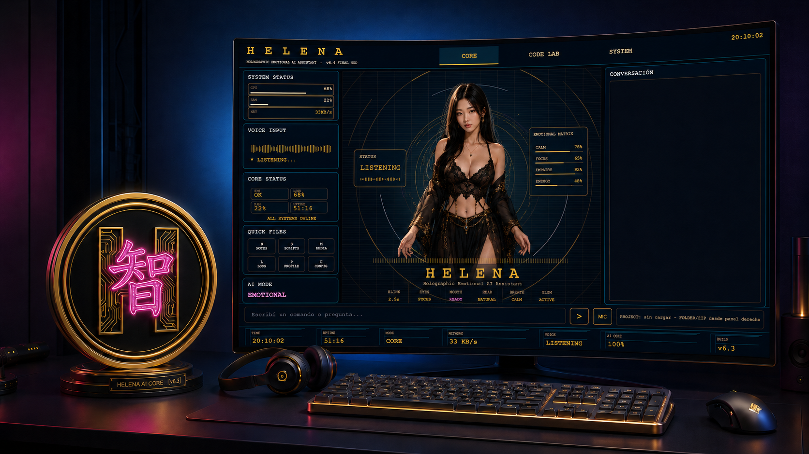
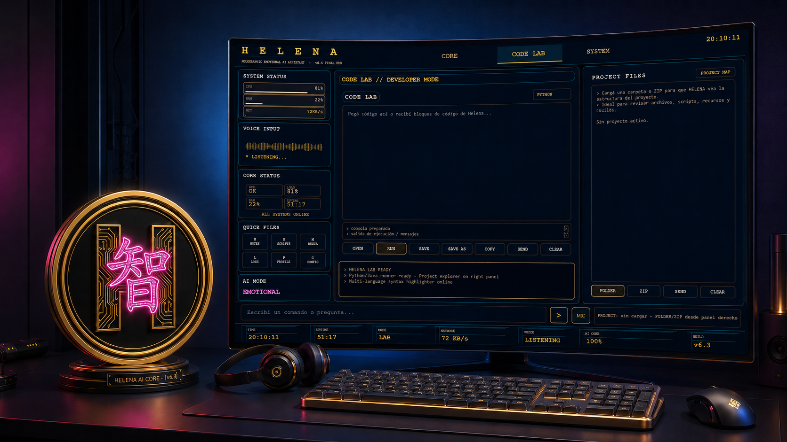
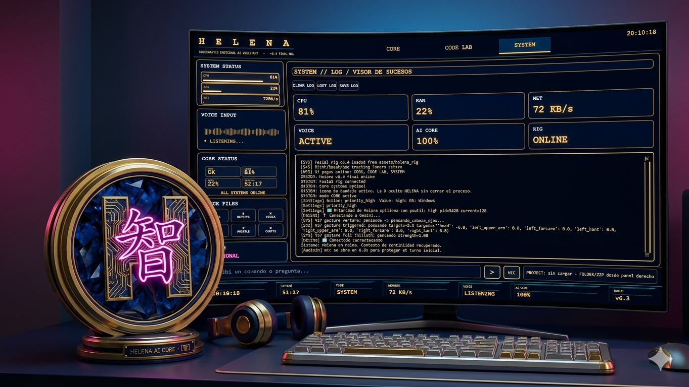

# Helena

Helena es un asistente de escritorio para Windows con interfaz gráfica, voz, herramientas para el equipo e integración opcional con Discord.

Esta guía está pensada para empezar desde cero. No hace falta saber programar, pero sí seguir los pasos en orden y mantener privadas tus claves.

## Así se ve Helena

**Pantalla principal**



**Code Lab**



**Estado del sistema**



## Antes de empezar

Necesitas:

- Windows 10 u 11.
- [Git para Windows](https://git-scm.com/download/win), para descargar el proyecto.
- [Python para Windows](https://www.python.org/downloads/windows/). Durante la instalación, marca **Add Python to PATH**.
- Una clave de Gemini para que funcione el asistente. Se crea gratis en [Google AI Studio](https://aistudio.google.com/app/apikey); el uso puede estar sujeto a límites y condiciones de Google.
- Conexión a Internet.

Helena puede interactuar con aplicaciones y funciones del equipo. Descarga el proyecto sólo desde una fuente en la que confíes y no compartas tus claves.

## 1. Descargar (clonar) Helena

Abre **PowerShell**: puedes buscar “PowerShell” desde el menú Inicio. Copia y ejecuta estos comandos, uno por uno:

```powershell
git clone https://github.com/zadkiel352/Helena.git
cd Helena
```

El segundo comando entra a la carpeta que acabas de descargar. Los comandos siguientes deben ejecutarse desde esa carpeta.

## 2. Preparar e instalar el proyecto

Crea un entorno de Python separado para Helena y actívalo:

```powershell
py -m venv .venv
.\.venv\Scripts\Activate.ps1
```

Si PowerShell bloquea la activación, permite scripts sólo en esta ventana y vuelve a ejecutar el comando de activación:

```powershell
Set-ExecutionPolicy -Scope Process -ExecutionPolicy Bypass
.\.venv\Scripts\Activate.ps1
```

Instala las dependencias:

```powershell
python -m pip install --upgrade pip
python -m pip install -r requirements.txt
```

La instalación puede tardar unos minutos. Mantén abierta la misma ventana de PowerShell.

## 3. Crear una clave de Gemini

Gemini es el servicio de inteligencia artificial principal que Helena necesita.

1. Abre [Google AI Studio: crear una clave API](https://aistudio.google.com/app/apikey) e inicia sesión con tu cuenta de Google.
2. Pulsa **Create API key** (crear clave API) y sigue las instrucciones.
3. Copia la clave. Trátala como una contraseña: no la publiques ni la envíes a otras personas.

La primera vez que abras Helena, aparecerá una ventana de configuración. Pega la clave en **CLAVE API GEMINI** y guarda. La casilla **CLAVE API OPENROUTER** es opcional; si quieres usarla, puedes crear una clave en [OpenRouter](https://openrouter.ai/keys).

Helena guarda esta configuración en `config/api_keys.json`. Si prefieres configurarla manualmente, crea ese archivo con este contenido y reemplaza los textos indicados:

```json
{
  "gemini_api_key": "PEGA_AQUI_TU_CLAVE_DE_GEMINI",
  "openrouter_api_key": "",
  "os_system": "windows",
  "discord_bot_token": "",
  "discord_guild_id": "",
  "discord_voice_channel_id": "",
  "discord_text_channel_id": "",
  "discord_music_text_channel_id": ""
}
```

Deja las opciones de Discord vacías si no vas a conectarlo. En JSON, conserva las comillas y no agregues comas después del último elemento. No necesitas claves de OpenAI o Anthropic para iniciar Helena.

## 4. (Opcional) Conectar Helena a Discord

Para esta parte necesitas tener un servidor de Discord y permiso para agregarle una aplicación.

### Crear e invitar el bot

1. Abre el [Portal de desarrolladores de Discord](https://discord.com/developers/applications) e inicia sesión.
2. Pulsa **New Application**, ponle un nombre y créala.
3. En la sección **Bot**, crea el bot si Discord lo solicita. Pulsa **Reset Token** o **View Token** y copia el token. Este token es secreto: no lo confundas con una clave API y nunca lo publiques.
4. Abre **OAuth2 → URL Generator**. En **Scopes**, selecciona `bot`. En permisos del bot, selecciona como mínimo **View Channels**, **Send Messages**, **Read Message History**, **Connect** y **Speak**. Para que el panel de música pueda mostrar sus controles, añade también **Embed Links**.
5. Copia la URL generada, ábrela en el navegador y sigue los pasos para invitar el bot a tu servidor.
6. En Discord, activa **Modo desarrollador** en **Ajustes de usuario → Avanzado**. Haz clic derecho en tu servidor y en el canal de voz que quieras usar, y elige **Copiar ID**. Si usarás un canal de texto, copia también su ID.

### Pegar el token y los IDs

Abre `config/api_keys.json` y completa los campos de Discord. Por ejemplo:

```json
{
  "gemini_api_key": "TU_CLAVE_DE_GEMINI",
  "openrouter_api_key": "",
  "os_system": "windows",
  "discord_bot_token": "TOKEN_SECRETO_DEL_BOT",
  "discord_guild_id": "ID_DE_TU_SERVIDOR",
  "discord_voice_channel_id": "ID_DEL_CANAL_DE_VOZ",
  "discord_text_channel_id": "ID_DEL_CANAL_DE_TEXTO",
  "discord_music_text_channel_id": "ID_DEL_CANAL_PARA_EL_PANEL_DE_MUSICA"
}
```

Reemplaza cada texto de ejemplo con tu valor real. Los IDs se pegan como texto entre comillas; si no tienes un canal de texto o no usarás el panel de música, deja esos campos como `""`. `discord_guild_id` puede dejarse vacío si no necesitas indicar el servidor.

Guarda el archivo y vuelve a iniciar Helena. En el cuadro de conversación de la aplicación, puedes pedirle, por ejemplo: **“Entra al canal de voz de Discord”**. Helena usará el ID indicado en `discord_voice_channel_id`.

> **Privacidad de voz:** Helena no escucha a todos los participantes de forma predeterminada. La recepción de audio de Discord se desactiva inicialmente; no actives la escucha de otras personas sin su conocimiento y consentimiento.

## 5. Iniciar Helena

Desde PowerShell, dentro de la carpeta `Helena` y con el entorno `.venv` activado, ejecuta:

```powershell
python main.py
```

La primera vez, completa la configuración de Gemini si aparece. En los siguientes inicios puedes volver a ejecutar el mismo comando.

## Solución de problemas comunes

- **`git` o `py` no se reconoce:** instala Git o Python con los enlaces de esta guía y vuelve a abrir PowerShell.
- **No se activa el entorno:** usa los dos comandos de la sección 2 para permitir la activación temporalmente.
- **Helena pide configurar una clave otra vez:** comprueba que `config/api_keys.json` contiene `gemini_api_key` y `"os_system": "windows"`, y que el JSON no tiene errores de formato.
- **El bot no entra a voz:** verifica que el token sea correcto, que el bot esté invitado al servidor, que tenga permisos de **Connect** y **Speak**, y que `discord_voice_channel_id` sea el ID de un canal de voz.
- **La música no se reproduce:** comprueba los permisos del bot y consulta [la guía de música de Discord](docs/DISCORD_MUSIC.md). La reproducción también requiere FFmpeg instalado y disponible en `PATH`.

## Mantener privadas tus claves

No publiques ni compartas `config/api_keys.json` o `.env`. El repositorio excluye estos archivos de Git, pero revisa siempre los cambios antes de subirlos. Si por accidente publicas un token o una clave, revócala en el portal del servicio y genera otra.

## Documentación adicional

- [Control del navegador](docs/BROWSER_CONTROL.md)
- [Reproductor de música de Discord](docs/DISCORD_MUSIC.md)
